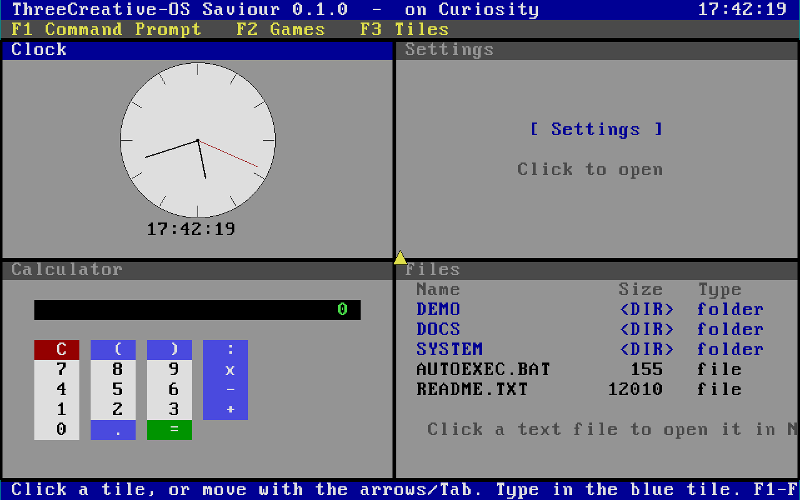

# ThreeCreative OS Saviour 0.2.0

A Windows 1-inspired desktop prototype, built as a bootable x86_64 disk image for experimentation, demos, and early-stage personal computing exploration.

This project is a concept OS distribution focused on a nostalgic, lightweight desktop experience. It is intended for enthusiasts, testers, and early adopters who want to boot a custom environment in a virtual machine or on supported hardware.

**Note:** ThreeCreative OS Saviour 0.2.0 runs on the ThreeCreative-DOS Curiosity platform. There are no missing drivers for supported Curiosity hardware — the image includes the necessary drivers and integration to run on Curiosity installations.

## Highlights

- Windows 1-inspired interface and layout
- Lightweight desktop experience aimed at experimentation
- Bootable x86_64 image suitable for USB install or VM testing
- Built for early testing and demonstration purposes
- Designed and distributed by ThreeCreative

## Features

Saviour includes the following features out of the box:

- Tile interface — the desktop is made up of separate tiles (clock, notepad, calculator, file manager, etc.) that can host different apps.
- Mouse control — full mouse support alongside keyboard navigation.
- Drivers — built-in support for storage, network cards, and common peripherals (Saviour uses Curiosity's driver stack).
- Games — a small built-in games collection launchable from the UI.
- Octell — ThreeCreative's built-in web browser (runs in the DOS background environment where applicable).
- Wifi — wireless network connectivity with support for secured networks.
- Settings — a central control panel for system, network, and display settings.
- Defender — built-in security software to scan for threats and protect the system.

## Screenshots



*ThreeCreative OS Saviour 0.1.0 running on Curiosity, showing the desktop tiles, clock, calculator, files, and settings interface.*

## System requirements

- x86_64-compatible machine or virtual machine
- USB drive or disk image writer
- 1 GB RAM minimum recommended for testing
- Virtualization support recommended for safe evaluation

## Quick start

### Option 1: Boot from USB on Windows

1. Download the release archive.
2. Extract `ThreeCreative-OS-Saviour-0.2.0-x86_64.img`.
3. Use Rufus to write the image to a USB stick.
4. Reboot and enter BIOS/UEFI setup if USB boot is disabled.
5. Select the USB device as the boot target.

### Option 2: Boot in a virtual machine

Use a VM such as QEMU, VirtualBox, or VMware and attach the extracted `.img` as a hard disk.

Example with QEMU:

```bash
qemu-system-x86_64 -m 1024 -hda ThreeCreative-OS-Saviour-0.2.0-x86_64.img -boot c
```

## Important warnings

This is an early alpha project. It may contain incomplete functionality, rough UI behavior, or technical instability. This project is not an endorsed or production-grade operating system release.

WARNING: This project is not a safe replacement for a production system. Do not write the image to a drive containing important data without a backup. Always test in a VM or on a disposable device first.

## Project status

Status: In development — Saviour is built on the same foundation as ThreeCreative-DOS Curiosity. Curiosity itself is finished with almost no errors and provides the underlying DOS environment and driver stack that Saviour uses. The DOS environment also supplies the Octell browser that Saviour can access.

This release is intended to demonstrate the concept and gather feedback, evaluation, and interest. It is not presented as a finished commercial product or open-source OS distribution.

## Changelog

See `CHANGELOG.md` for release history.

## Contributing

See `CONTRIBUTING.md` for contribution rules, bug reporting expectations, and how to request support or feature work.

## Security and verification

For release verification, see `CHECKSUMS.txt`.

Keep in mind that a detached signature file may be added later when a private key is available for signing release artifacts.

---

ThreeCreative OS Saviour is a concept operating system experience inspired by classic desktop systems. It is presented as a prototype, not a complete production operating system.
